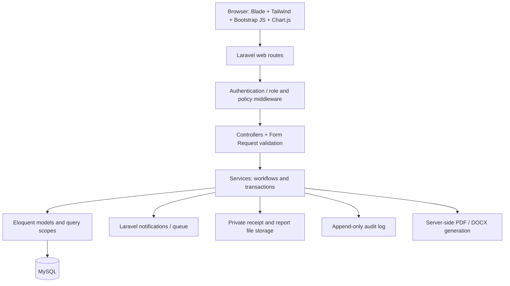

# Application Architecture (Laravel modular monolith)

## Request/data flow


## Project directories
```text
jci-carmona-pms/
  AGENTS.md
  README.md
  .env.example
  docs/ (all blueprint files)
  app/
    Enums/{Role,ProjectStatus,TaskStatus,ReportStatus}.php
    Models/{User,MemberProfile,RegistrationReview,Project,ConceptProposal,ProposalReview,
            BodResolution,ProjectChairAssignment,ProjectPlan,ProjectTask,TaskAssignment,
            ProjectEvent,ProjectBudget,FinancialTransaction,TransactionAttachment,
            MemberDue,DuePayment,CompletionReport,LiquidationReport,ReportReview,
            Notification,AuditLog}.php
    Policies/{ProjectPolicy,TaskPolicy,FinancePolicy,ReportPolicy,UserPolicy}.php
    Http/Controllers/{Auth,Members,Projects,Tasks,Finance,Reports,Notifications}/
    Http/Requests/{Members,Projects,Tasks,Finance,Reports}/
    Services/{RegistrationService,ProposalWorkflowService,TaskService,FinanceService,
              ReportWorkflowService,ExportService,AuditService}.php
  database/{migrations,seeders,factories}/
  resources/{views,css,js}/
  resources/views/{layouts,auth,dashboard,projects,tasks,calendar,finance,members,
                   documents,notifications,reports,archive,profile,admin}/
  resources/js/{charts,forms,utils}/
  routes/{web.php,console.php}/
  public/images/branding/jci-logo.png
  storage/app/private/{receipts,reports,documents}/
  tests/{Feature,Unit}/
  tests/js/*.test.js
  vite.config.js
  vitest.config.js
```

## Practical conventions
- Server-render pages with Blade. Use small vanilla JS modules for interactivity; Chart.js directly through Vite. No React and no API microservice required.
- Tailwind controls layout/colors; if Bootstrap is used for modals/dropdowns, import selective Bootstrap JS and avoid broad Bootstrap CSS conflicts.
- Controllers stay thin; validations use Form Requests; complex rules in Services and Policies; database writes in `DB::transaction(...)`.
- Laravel authentication with session cookies, CSRF protection, password hashing and email verification if configured. Rate-limit login and sign-up.
- Use database-backed notifications initially; queue jobs can later handle email. Failures must not roll back otherwise valid approvals unless required by policy.
- File uploads: protected storage, validation for type/size, randomized filename, authenticated downloads; receipts and submissions are not public.
- Use `decimal(15,2)` for monetary fields, avoid floating point, require currency definition (PHP) and transaction audit trails.
- Prefer MySQL `InnoDB`, foreign keys, indexed reviewer/status/project fields, timezone-aware timestamps; project concurrency protected with database locks/version checks.
- Avoid self-approval: project chair cannot sign off their own PCR/liquidation. Escalation path to another authorized officer must be defined by the chapter.
- Report generation: fill chapter-approved JCI templates, create downloadable PDF/DOCX, record generated file metadata; use Arial 11.

## XAMPP details
- XAMPP provides development services, not a requirement to use an outdated PHP version. Update PHP/XAMPP or use another local PHP runtime if the selected Laravel version is incompatible.
- Database service may ship MariaDB in some XAMPP packages; verify actual server/version. The target design is MySQL 8.x, and migrations must be checked against the actual service used.
- `php artisan serve` + XAMPP MySQL works without Apache integration. With Apache, configure a vhost whose DocumentRoot is **the Laravel `/public` folder**.
- Deploy later to an environment with supported PHP/MySQL, HTTPS, queue worker, secure storage and backups; do not use XAMPP as internet production hosting.
