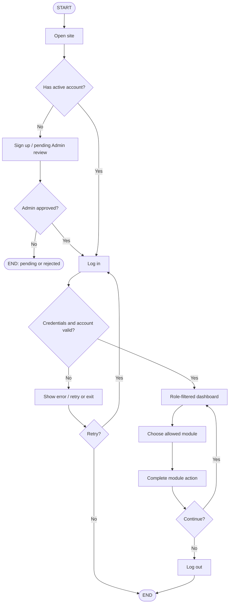
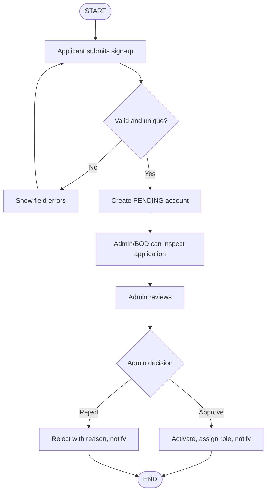
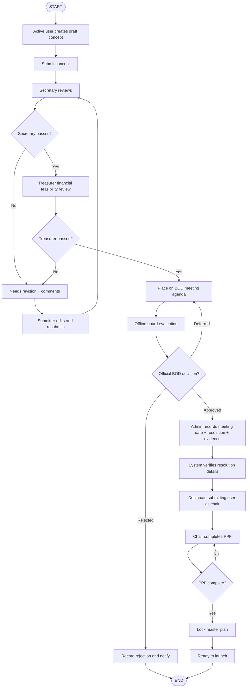
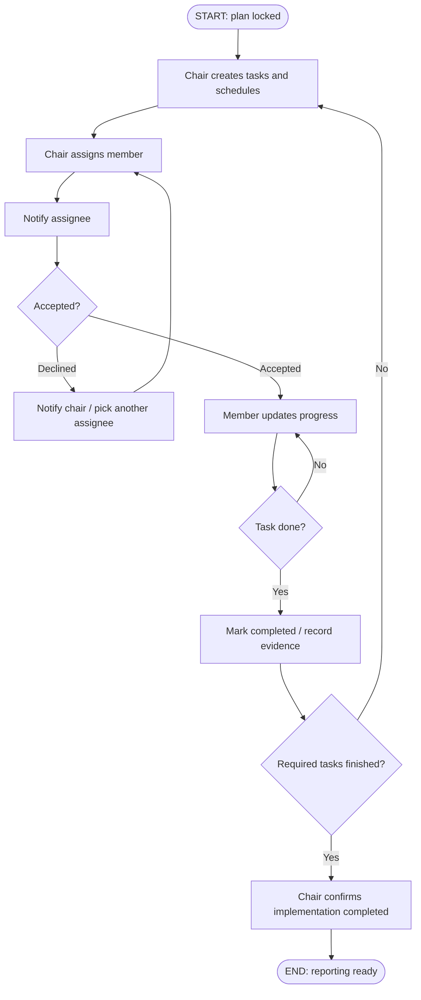
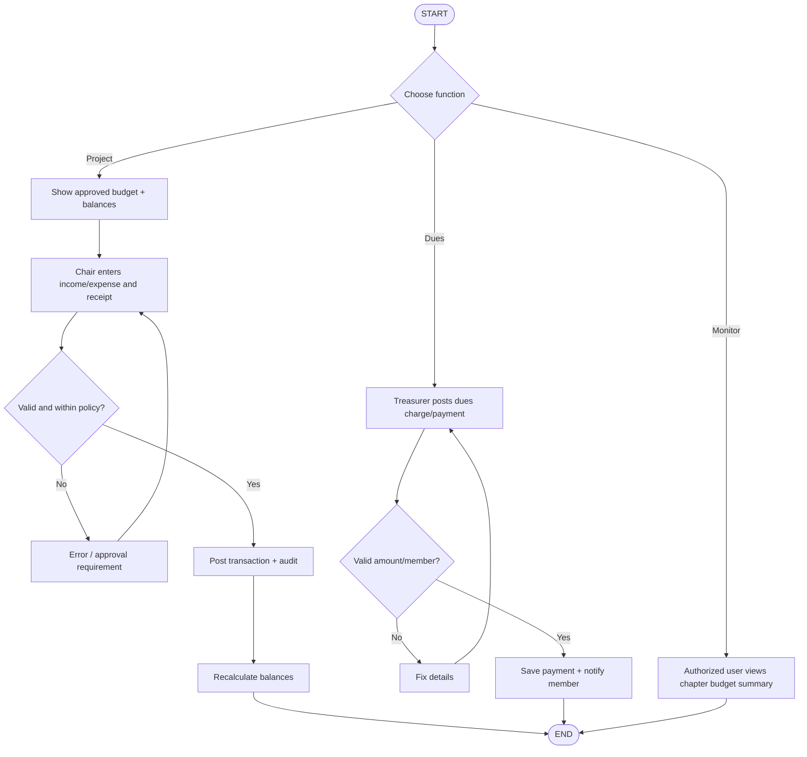
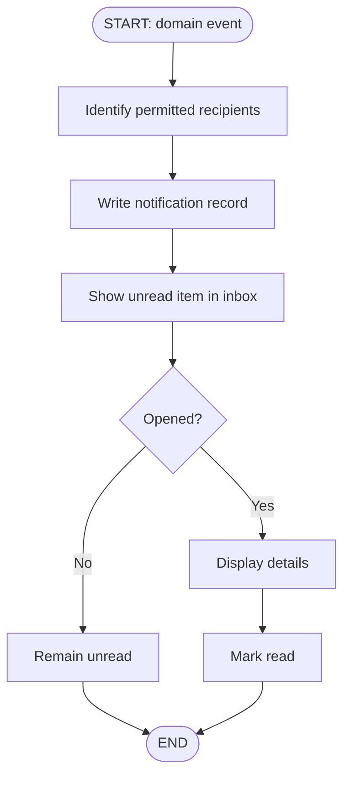
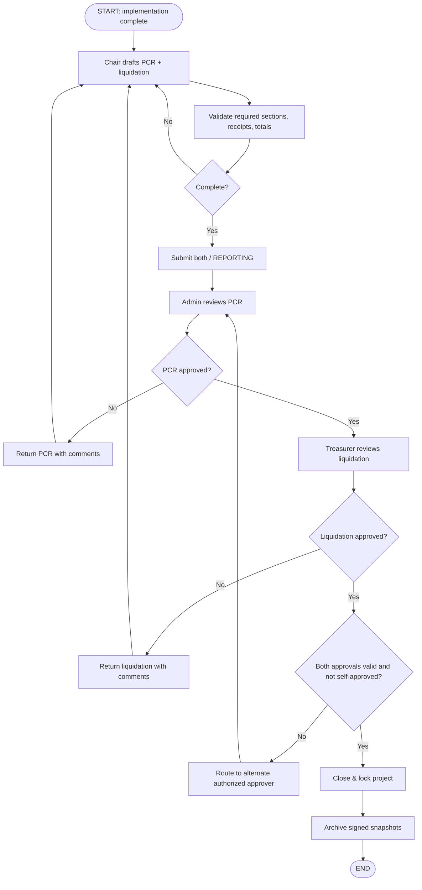

# Workflows, decisions, and valid transitions

Every standalone flow has one START, one or more clearly routed decisions, and an END. "End" of a module action returns to the UI; it does not mean logout.

## 1. Overall access

## 2. Member registration

BOD can edit permissible profile data and view applications; cannot approve/reject/activate or grant elevated roles. Never make a `PENDING` account authenticated for app access.

## 3. Proposal and BOD authorization

Review/revision is not BOD rejection. BOD official decision cannot be manufactured via one click by a non-authorized actor. `chairUserId` is assigned only after validated approval record.

## 4. Tasks and scheduling

Other users can view chapter task status but cannot edit tasks unless chair or assigned. Chair can update deadlines with audit event, respecting approved plan change policy.

## 5. Project finance and membership dues

Use decimal money arithmetic, explicit currency `PHP`, no negative amount hack for refunds; adjustments are linked reversal records. All users can monitor aggregate budgets/expenses, not private receipts or other people's dues.

## 6. Notifications

Create notifications on sign-up decisions, proposal reviews, BOD decisions, task assignment/decline/deadlines, report revisions/approvals, and dues reminders. Avoid duplicate sends using event idempotency keys.

## 7. PCR, liquidation, closure

In implementation, a returned **liquidation** should re-enter only Treasurer review after correction while retaining a still-valid approved PCR; returned PCR re-enters only PCR review. This avoids unintended loss of prior approvals. Approval should be invalidated only if changed data affects what was approved.

## Proposal status transition table

| From | Event | To | Who |
|---|---|---|---|
| DRAFT | submit | SUBMITTED | proposer |
| SUBMITTED | begin admin review | UNDER_SECRETARY_REVIEW | Admin |
| UNDER_SECRETARY_REVIEW | needs correction | NEEDS_REVISION | Admin |
| NEEDS_REVISION | resubmit | UNDER_SECRETARY_REVIEW | proposer |
| UNDER_SECRETARY_REVIEW | passed | UNDER_TREASURER_REVIEW | Admin |
| UNDER_TREASURER_REVIEW | needs correction | NEEDS_REVISION | Treasurer |
| UNDER_TREASURER_REVIEW | passed | BOD_AGENDA | Treasurer |
| BOD_AGENDA | BOD rejected + recorded | REJECTED | Admin records official decision |
| BOD_AGENDA | BOD approved + resolution recorded | APPROVED_BY_BOD | Admin records official decision |
| APPROVED_BY_BOD | full PPF valid and locked | PLAN_LOCKED | Chair (lock subject to policy) |
| PLAN_LOCKED | launch | LAUNCHING | Chair |
| LAUNCHING | required activities complete | REPORTING | Chair |
| REPORTING | valid PCR + liquidation approvals | ARCHIVED | system transaction |

No transition from `REJECTED` to `APPROVED_BY_BOD` without a **new** submission and full reviews. A `CANCELLED` state can be initiated only by Admin with recorded reason (policy choice).

## Core invariants

- Every approval/denial/revision is timestamped and attributable to a real actor.
- BOD resolution number/date/evidence must exist before chair access begins.
- Audit ledger records prior and new status; statuses cannot be directly edited through generic CRUD.
- A project cannot archive with missing PCR approval, liquidation approval, or outstanding required activities.
- No report can be self-approved; a delegated approver must be configured as needed.
